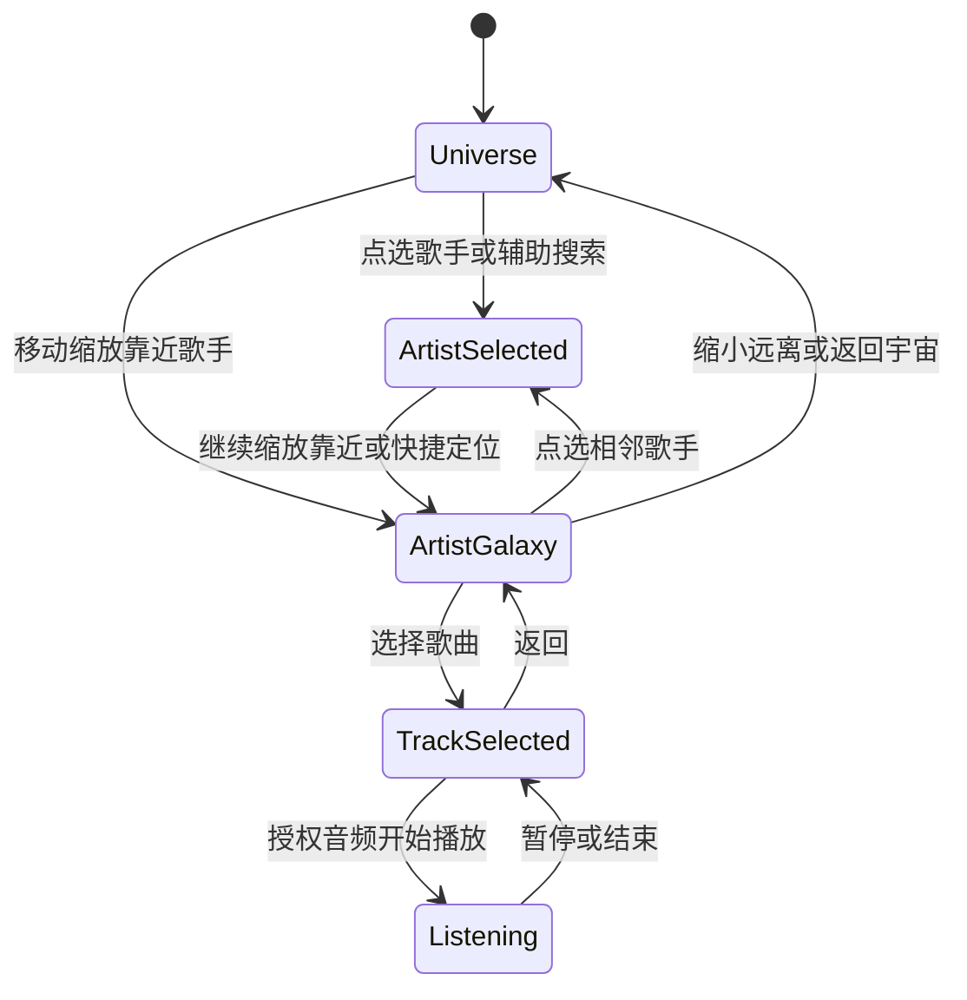
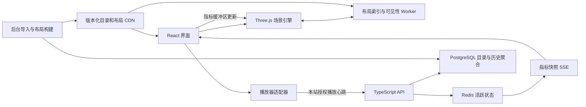

# 音乐星际：产品设计与开发文档

版本：v0.2 · 调研日期：2026-10-12 · 状态：交互原型开发中，尚未完成 P0 或设备压测

## 1. 项目目标与核心决策

音乐星际是一款通过三维星空探索歌手与歌曲的 Web 应用。风格形成星云，歌手拥有自己的星系，歌曲在星系内部形成星球。热度影响大小与亮度，本站正在共同收听的活跃听众数影响光晕的起伏幅度。

用户应能完成这条主要路径：**在星空中移动和缩放 → 发现感兴趣的歌手星点 → 靠近后展开歌曲 → 点击查看和播放 → 继续移动、缩放，发现下一位歌手。** 搜索是快速定位的辅助入口，不是进入星系的前提。

第一版采用以下决策：

| 事项 | 决策 | 原因 |
|---|---|---|
| 产品形态 | 桌面浏览器优先，移动端可降级 | 先验证探索体验与性能 |
| 场景规模 | 首批 200 位歌手、约 1,000 首歌曲 | 足以呈现分区和探索路径，便于核对数据 |
| 歌手的视觉表现 | 远处是星点，近处展开为小型星系 | 满足“一位歌手一个星系”，控制同屏成本 |
| 空间组织 | 风格为主布局，国家/地区和语言为筛选 | 跨风格歌手仍保留唯一位置 |
| 热度含义 | 本站最近 30 天/7 天有效播放指标；启动阶段为标注的演示数据 | 避免将局部样本称为全球流行度 |
| 当前人数 | 本站可观测播放器的活跃听众估计 | 不能直接获取全球平台同时收听人数 |
| 音频 | 优先使用作者授权且允许分析/可视化的演示曲库 | 让音频律动与本站统计具备可实施基础 |
| 平台歌曲 | 提供经过验证的外链；平台播放接入通过适配器扩展 | 外链点击不代表实际收听 |
| 技术 | React + TypeScript + Vite，独立 Three.js 渲染引擎 | UI 与逐帧动画分别管理 |
| 参考代码 | 借鉴并按需移植渲染思路，核心产品新建 | 参考项目的数据、坐标和服务依赖较重 |

以上数量和性能预算均为**建议的初始目标**，不是现成项目已经达到的结果。开发前不需要完成全球曲库，也不把全球实时人数作为上线前提。

## 2. 参考项目调研与设计取舍

### 2.1 调研范围和证据等级

本次对 Music Galaxy / Spotifytrack 阅读了作者技术文章与工作区源码，并通过 GitHub 接口核对了上游关键文件。对 Musicmap 与 Music-Map 阅读了官方产品说明/页面信息；没有取得或验证它们的服务端源码，也没有将阅读说明当作浏览器实测。

工作区已有的 `spotifytrack` checkout 指向 `hfd9/spotifytrack`，当前提交为 `82d155c54dd016ad50d03af76cfb6d1a6ab4f236`。该提交在 GitHub 已核实存在。关键渲染与音频片段也与 `Ameobea/spotifytrack` 默认分支交叉核对。下文的代码证据链接固定到该 checkout 的提交，避免后续分支更新导致证据漂移。[调研提交](https://github.com/hfd9/spotifytrack/commit/82d155c54dd016ad50d03af76cfb6d1a6ab4f236)

### 2.2 Music Galaxy / Spotifytrack

作者介绍的是约 7 万位歌手构成的三维关系空间，相似受众的歌手更接近。歌曲示例可产生音频驱动的球体脉动，个人喜好可形成高亮星座。它证明了“音乐关系空间＋星空探索”的实现路径，但没有证明我们能获取全球实时听众。[作者技术文章](https://cprimozic.ameo.dev/blog/building-music-galaxy/)

| 已核实的模块 | 实现观察 | 对音乐星际的建议 |
|---|---|---|
| `ArtistMapInst.ts` | `InstancedMesh` 批量画歌手，容量设置为 70,000；容量不等于每帧全部可见 | 远景优先使用批量星点；近景少量实例模型 |
| `ArtistMapInst.ts` | 使用 Bloom 与合成通道形成发光；帧时间窗口触发画质调整 | 发光设独立预算，使用持续测量和升降级冷却 |
| `conf.ts` | 歌手大小、标签缩放、音频淡入淡出与画质参数集中配置 | 建立自己的 `visual-config.ts`，参数有上限和来源 |
| `DataFetchClient.ts` | 歌手名称分批获取；名称与关系请求有并发上限 | 目录、详情、关系分层加载，并加入取消与有限重试 |
| `WasmClient.worker.ts` | 使用 Comlink 与 Rust/WASM 引擎通信，转移数组缓冲区 | 第一版先使用 TypeScript Worker；根据实测再决定 WASM |
| `MusicManager.ts` | `AudioContext`、`AnalyserNode`、空间音频和淡入淡出 | 只对允许分析的音频启用律动；分析数组复用，减少逐帧分配 |
| `research/README.md` | 从关系图生成 node2vec 嵌入，再使用降维方法研究三维布局 | 有可靠关系数据后再做嵌入；初期用可解释的稳定布局 |
| `backend/src/artist_embedding/map_3d.rs` | 三维坐标依赖外部预生成文件，热度依赖 Spotify 字段 | 构建自有版本化布局和热度管道，避免运行时依赖作者服务 |

代码证据：[渲染引擎](https://github.com/hfd9/spotifytrack/blob/82d155c54dd016ad50d03af76cfb6d1a6ab4f236/frontend/src/musicGalaxy/ArtistMapInst.ts)、[配置](https://github.com/hfd9/spotifytrack/blob/82d155c54dd016ad50d03af76cfb6d1a6ab4f236/frontend/src/musicGalaxy/conf.ts)、[加载模块](https://github.com/hfd9/spotifytrack/blob/82d155c54dd016ad50d03af76cfb6d1a6ab4f236/frontend/src/musicGalaxy/DataFetchClient.ts)、[Worker](https://github.com/hfd9/spotifytrack/blob/82d155c54dd016ad50d03af76cfb6d1a6ab4f236/frontend/src/musicGalaxy/WasmClient/WasmClient.worker.ts)、[音频模块](https://github.com/hfd9/spotifytrack/blob/82d155c54dd016ad50d03af76cfb6d1a6ab4f236/frontend/src/musicGalaxy/MusicManager.ts)、[布局研究](https://github.com/hfd9/spotifytrack/blob/82d155c54dd016ad50d03af76cfb6d1a6ab4f236/research/README.md)、[后端布局数据](https://github.com/hfd9/spotifytrack/blob/82d155c54dd016ad50d03af76cfb6d1a6ab4f236/backend/src/artist_embedding/map_3d.rs)。

该项目使用 MIT 许可证，移植实质性代码时保留作者版权和许可。代码许可不等于获得歌曲、图片、第三方数据或托管服务的使用权。[上游许可证](https://github.com/Ameobea/spotifytrack/blob/main/LICENSE)

### 2.3 Musicmap

官方说明呈现了按层级缩放的风格地图：远景看大类，靠近看子类；悬停突出关联，点击打开介绍和代表歌曲。它适合借鉴导航、语义分层和关系高亮，而不适合作为实时听众系统的依据。官网明确保留内容版权，因此本项目独立编写风格描述与视觉资产。[官方说明与版权声明](https://musicmap.info/)

本项目采用“先展示能理解的分区，再按需展开细节”，并允许歌曲/歌手拥有多个风格标签。位置是探索辅助，不是唯一正确的音乐分类。

### 2.4 Music-Map

官方页面以歌手为探索起点，并说明名字越接近，用户同时喜欢两者的概率越高；点击另一个名字可继续探索。这里的接近表示共同偏好，并不保证音频听起来相似。[官方页面示例](https://www.music-map.com/closer)

本项目借鉴连续探索路径：点击相邻歌手可定位其星系，并保留返回历史。没有验证其后端算法、数据授权或公开 API；开发方案不依赖抓取 Music-Map 的推荐结果。

### 2.5 形成的产品差异

| 参考方向 | 音乐星际的具体变化 |
|---|---|
| 三维歌手关系点阵 | 靠近歌手后展开歌曲星系，形成从宇宙到歌曲的尺度变化 |
| 风格知识地图 | 风格和国家/地区辅助探索，不强制单一归属 |
| 相似歌手跳转 | 通过可解释的邻居卡片和短关系线延续探索 |
| 音频驱动脉动 | 分开表达长期热度、近期热度、本站当前听众与音频能量 |

## 3. 用户任务与首版范围

### 3.1 主要用户任务

1. 通过移动、缩放和点选发现歌手，靠近星系并浏览歌曲；也可搜索熟悉的歌手快速定位。
2. 在风格或国家/地区筛选下，发现原本不知道的歌手。
3. 观察本站哪些歌曲正在被共同收听，并加入试听。
4. 收藏发现，沿相关歌手继续探索，随时返回之前的位置。

衡量产品价值时优先看“发现了多少新音乐、是否继续探索”，不只看星空停留时长。

### 3.2 阶段与功能边界

| 阶段 | 必须交付 | 数据性质 | 退出条件 |
|---|---|---|---|
| P0：可交互原型 | 三维星空、搜索定位、风格/地区筛选、歌手展开、歌曲卡片、光晕脉动、质量设置 | 固定种子的演示目录和模拟指标，页面明确标注 | 探索路径可完成，代表设备上的性能问题可定位 |
| P1：公开 MVP | 真实授权试听、收藏、服务端心跳统计、热度指标、断线处理、分享链接 | 本站真实指标与已核对元数据 | 权利和数据来源具备记录，统计与关键路径通过验收 |
| P2：扩展 | 更大目录、关系图布局、个人星座、国家分组视图、可选平台接入 | 可用且允许使用的数据 | 由 P1 用户反馈与性能结果决定投入 |

P0 可在静态站点独立运行；P1 才引入服务端。聊天室、用户地理位置地图、完整商业曲库、多人同步播放和大规模推荐训练不属于本轮 MVP。

## 4. 信息结构、页面与交互

### 4.1 视觉层级

| 尺度 | 展示内容 | 标签 | 交互 |
|---|---|---|---|
| 宇宙 | 风格星云、歌手远景星点、稀疏背景星 | 风格名和少数重点歌手 | 旋转、缩放、搜索、筛选 |
| 星域 | 可辨认的歌手星系核心、少量相关连线 | 当前区域的歌手名 | 悬停、点选、进入星系 |
| 歌手星系 | 中心歌手与最多 20 个歌曲节点 | 精选歌曲名 | 选择歌曲、浏览完整歌曲列表 |
| 歌曲聚焦 | 一首歌的主星球、详细卡片、共同收听数 | 歌曲/歌手和状态 | 播放/暂停、收藏、外链、返回 |

“最多 20 个”限制三维同屏歌曲数量；更多歌曲进入侧栏分页。全目录存在不代表全部对象同时渲染。

### 4.2 页面骨架

```text
┌ 音乐星际 ─ 搜索歌手/歌曲 ─ 风格 ─ 国家/地区 ─ 收藏 ┐
│                                                   │
│                 可旋转缩放的星空                  │
│                                    ┌ 详情面板 ┐   │
│                                    │ 歌手/歌名│   │
│                                    │ 来源/标签│   │
│                                    │ 歌曲列表 │   │
│                                    │ 相邻歌手 │   │
│                                    └──────────┘   │
├ 返回宇宙 / 当前位置 ─ 图例 ─ 动效 / 画质            ┤
└ 当前播放 ─ 播放/暂停 ─ 音量 ─ 本站共同收听状态       ┘
```

桌面详情面板建议宽 320–360 CSS 像素；手机改为底部抽屉。按钮和文字采用清晰的常规界面，不让粒子或光晕遮住操作。

### 4.3 核心交互规则

- 默认使用轨道旋转与缩放，首次进入不要求锁定鼠标或学习 WASD。
- 单击歌手选中并打开卡片；保持当前视角，不自动连续飞行。靠近歌手时自然展开歌曲，远离时收起；“靠近这位歌手”只作为可选快捷定位，不能成为进入星系的必经步骤。切换展开对象设置不同的进入/退出距离，避免临界距离闪动；歌曲详情和播放状态独立于展开对象，用户播放时仍可继续探索。
- 搜索结果显示名字、类型、国家/地区和必要的同名消歧信息。找不到时显示空状态，可清除筛选。
- 镜头过渡建议 0.6–1.2 秒，可中断；减少动态效果模式直接定位或只做淡入。
- 返回保留上一层镜头、筛选和选中对象。新搜索取消未完成的定位与旧详情请求。
- 相邻歌手最多显示 6–10 位；每条关系有“风格标签接近”“编辑推荐”或“本站共同偏好”等来源。
- 筛选优先降低非匹配对象亮度，降低迷失感；可再切换为只显示匹配对象。空结果有数量提示。
- 首页保留“随便探索一颗星”入口，对冷门歌手给予独立曝光；不以热度筛除整个长尾目录。
- P0 的图例与指标附近显示“演示数据”。P1 显示“本站热度”和“本站共同收听”，不用“全球实时”。

### 4.4 用户路径状态图



外链打开音乐平台后，本应用保持 `TrackSelected`，不自行转入 `Listening`。

## 5. 热度、亮度与脉动规则

### 5.1 指标定义

| 指标 | 默认含义 | 更新频率建议 | 视觉通道 |
|---|---|---|---|
| `longTermScore` | 本站最近 30 天有效播放量的归一化值 | 每小时 | 歌手核心/歌曲基础大小 |
| `recentScore` | 本站最近 7 天有效播放量的归一化值 | 每 5 分钟 | 基础亮度 |
| `activeListeners` | 当前有有效心跳的本站活跃听众估计 | 每 3 秒发布快照 | 光晕脉动幅度 |
| `audioEnergy` | 当前设备正在播放的可分析授权音频的平滑能量 | 本地逐帧/30 Hz 分析 | 当前选中歌曲局部律动 |

首次上线无历史数据时，真实指标为 0 或 `null`，保留最低可见亮度。编辑精选用独立徽标表示，不伪造为热度。

有效历史播放建议定义为累计播放超过 `min(30 秒, 可播放片段时长 × 50%)`，单次播放会话只计一次；拖动进度不能凭空增加累计播放。该口径应与产品标注一起版本化，且试听热度不能解释为完整歌曲消费量。

### 5.2 建议的映射公式

以下是本项目拟定公式，不是参考项目的原始算法：

```text
normalize(x, q95) = clamp(log(1 + max(0, x)) / log(1 + max(1, q95)), 0, 1)
size = minSize + (maxSize - minSize) * sqrt(longTermScore)
brightness = minBrightness + (maxBrightness - minBrightness) * recentScore
listenerAmplitude = 0.12 * normalize(activeListeners, listenerQ95)
haloScale(t) = baseHalo * (1 + listenerAmplitude * sin(2π * 0.65 * t + phase))
```

`q95` 是同一指标、同一实体类型和时间窗的参考分位数；`listenerQ95` 在服务端按滚动窗口更新，不每帧重算。歌手和歌曲分别归一化。筛选改变不重算全局分母，便于跨地区比较；局部相对榜单另行标注。

人数为 0 时，人数驱动的光晕不脉动；背景闪烁仍可缓慢存在。人数为 `null` 时表现为未知，不能当成 0。新的目标值平滑过渡约 0.8 秒，避免人数波动导致画面突跳。

**人数越多，幅度越大，频率保持舒缓。** 有音频分析权限时，再给当前歌曲叠加不超过 8% 的局部缩放。音量能量不是节拍检测；需要精确随鼓点跳动时另开发并验证 beat detector。所有幅度最终封顶，减少动态效果模式关闭缩放和闪烁。

## 6. 空间布局与关系算法

### 6.1 首版布局

1. 编辑设定 8–12 个风格星云中心，保留名称、颜色和说明。
   星云呈不规则云团，不使用统一漩涡/旋臂形状。每块区域的规范歌手实体数量决定整体浓度与亮度，节点的局部空间密度决定云团内部的亮暗和聚集形态；多节点区域更浓、更亮，少节点区域更疏、更淡，空区域不生成实体驱动云气。装饰星尘不计入数量，歌手热度仍单独作用于核心大小/亮度。使用固定随机种子和固定密度尺度，使轮廓稳定、不同区域可比较。
2. 歌手拥有多个加权风格标签，按加权中心确定基础位置；无可靠标签进入“待分类”星域。
3. 根据内部歌手 ID 生成稳定的小范围偏移，再离线做最小间距松弛，避免重叠。
4. 国家/地区和语言作为独立属性；不由播放市场、歌曲语言或名字推断歌手国籍。
5. 一个歌手只有一个规范实体和主坐标；跨风格关系用标签与邻居说明，不在每个星云复制实体。
6. 歌曲局部轨道使用 ID 决定角度与半径；只有当前展开星系加载歌曲节点。

该布局表达风格邻近与编辑组织，不宣称精确的受众相似度。热度改变视觉大小，不改变位置，防止热门歌曲每天漂移。

构建产物包含 `layoutVersion`、随机种子、坐标、分区和索引。目录增长时发布新版本；旧分享链接若对象仍在，应按 ID 在新布局重新定位。

### 6.2 后续关系图

有合法、可靠数据后，可离线使用图嵌入或力导向布局。边需区分：风格相近、合作关系、编辑推荐、本站共同偏好。音频相似与受众相似是不同概念，不能混用。

先验证邻居质量再生成空间：人工抽样不同风格和地区、检查跨界歌手、记录来源置信度。布局只在后台构建，浏览器负责显示；不在用户打开页面时训练模型或重算全图。

每个歌手只展示少量相关边，默认全图不画密集关系网。P2 重新布局需要保留分区锚点、做新旧坐标对齐，并给镜头切换留过渡。

## 7. 数据来源与音频接入

### 7.1 数据能力矩阵

| 所需数据 | 首版获取方式 | 缺失时处理 |
|---|---|---|
| 名字、别名、歌手/歌曲 ID | 编辑维护，候选元数据可查 MusicBrainz | 标记待核对，不仅按名字自动合并 |
| 国家/地区关联 | 编辑核对来源，保留来源与置信度 | `null` / 未知；地区关联不等于公民身份 |
| 风格与歌曲语言 | 编辑标签或允许使用的元数据 | 未分类/未知 |
| 歌手头像、封面 | 自制占位图或有记录的授权资产 | 可用纯色星球，不依赖外部图片 |
| 试听音频 | 作者授权且允许本站播放、分析及可视化的曲库 | 显示外链，保留按指标驱动的光晕 |
| 热度 | 本站有效播放聚合 | 真实零值；演示模式用明确标注的模拟值 |
| 当前人数 | 本站播放器心跳 | 未观测的平台收听不计入 |
| 歌手关系 | 编辑推荐和风格标签重叠 | 说明推荐来源，允许无邻居 |

MusicBrainz 是可选元数据来源，不提供我们的实时人数。其核心数据与补充数据许可不同：核心数据为 CC0，补充数据采用 CC BY-NC-SA 3.0。字段需要按所属数据集核对许可；不能把所有 API 响应都视为可任意商用。接口默认需遵守每 IP 平均约 1 请求/秒限制，并提供可联系的 User-Agent，适合后台导入和缓存。[数据库与许可](https://musicbrainz.org/doc/MusicBrainz_Database)、[API 规则](https://musicbrainz.org/doc/MusicBrainz_API/Rate_Limiting)

### 7.2 Spotify 与参考项目的现实差异

截至调研日，Spotify 开发模式在 2026 年调整了数据字段与端点，包括歌手/歌曲 `popularity`，以及相关歌手等能力；7 月又调整了开发模式配额计数。应以实际应用模式和官方现行规则验证，不能认为旧项目能运行就代表新应用能获取同样数据。[2 月变更](https://developer.spotify.com/documentation/web-api/references/changes/february-2026)、[7 月变更](https://developer.spotify.com/documentation/web-api/references/changes/july-2026)

“正在播放”接口只提供授权用户的播放对象，不是全球实时人数接口。[官方接口](https://developer.spotify.com/documentation/web-api/reference/get-the-users-currently-playing-track)

现行开发者政策限制录音与视觉媒体同步，以及从 Spotify 内容/服务分析衍生收听指标。因此，不默认把 Spotify 音频接入频谱分析，也不默认将授权用户播放数据聚合成本站人数或热度。需要有明确允许的接入依据后才能启用相关能力；MIT 源码许可不能解除平台限制。[开发者政策](https://developer.spotify.com/policy)

### 7.3 播放器能力契约

```ts
type PlaybackCapabilities = {
  canPlayHere: boolean;
  canObservePlayback: boolean;
  canAnalyzeAudio: boolean;
  canAggregateListeners: boolean;
  canVisualizeSynchronizedAudio: boolean;
};
```

能力由后台批准的音源配置提供，客户端不能自行开启。首个适配器为 `LicensedAudioAdapter`；`ExternalLinkAdapter` 仅跳转，以上能力均为 false。以后接入平台嵌入/SDK时分别核实能力，不把 iframe 存在视为能分析或统计。

音频由用户操作启动；处理浏览器自动播放拒绝、解码失败、跨域权限、授权过期和地区不可用。播放器唯一实例，切歌暂停前一首。启动音频失败时不发送收听心跳。直接音频分析需正确的 CORS；跨域平台音频不尝试绕过限制。

## 8. 技术架构与模块职责

### 8.1 分阶段架构



P0 使用静态 JSON 与内存模拟指标，完全省略 API、Redis、PostgreSQL 和 SSE。P1 引入单个 TypeScript 服务、PostgreSQL 与 Redis。目录与布局在构建时发布到 CDN，动态服务不承担逐帧渲染。

### 8.2 推荐技术和职责

| 模块 | 建议 | 职责 |
|---|---|---|
| 界面 | React + TypeScript + Vite | 搜索、面板、收藏、无障碍列表、设置 |
| 场景 | Three.js + 自定义 shader | 星点、实例星球、镜头、光晕、拾取 |
| UI 状态 | 小型集中 store；请求缓存独立 | 筛选/选择/播放状态；不储存每帧位置 |
| Worker | TypeScript Web Worker，可选 Comlink | 索引、候选可见集、标签候选和数据解码 |
| 动态 API | Node.js LTS + TypeScript + Fastify | 会话、目录查询、收藏、心跳、SSE |
| 持久数据 | PostgreSQL | 目录、来源、许可记录、有效播放与聚合 |
| 活跃状态 | Redis | 过期索引、去重、限流、共享快照 |
| 交付 | 静态 CDN + 单体 API + 托管数据库 | 先保持部署简单，按瓶颈扩展 |

开工时选择当前兼容的稳定版本并锁定依赖；不直接复制参考项目旧 Three.js 版本和 API。Rust/WASM、WebGPU、微服务都作为后续实测驱动的选项。

### 8.3 场景引擎接口

```ts
interface GalaxyEngine {
  loadCatalog(catalog: Catalog, layout: Layout): Promise<void>;
  focusArtist(id: string): Promise<void>;
  selectTrack(id: string | null): void;
  setFilters(filters: Filters): void;
  applyMetrics(snapshot: MetricsSnapshot): void;
  setQuality(tier: 'low' | 'medium' | 'high' | 'auto'): void;
  setReducedMotion(enabled: boolean): void;
  resize(width: number, height: number): void;
  dispose(): void;
}
```

React 处理用户状态和低频指标；`requestAnimationFrame` 内只更新时间、镜头和 GPU 参数。动画不触发逐星 React 状态更新。切换场景时取消旧加载；`dispose()` 释放监听器、Worker、动画循环、几何、材质、纹理和渲染目标。

## 9. 三维效果与性能设计

### 9.1 渲染策略

- 背景星与远景歌手使用 `Points` 或实例化朝向相机的小片面，批量绘制；背景星仅作装饰，没有歌手 ID，不能计入目录。
- 当前星系近景使用共享低面数几何，最多展开 20 首歌曲；选中歌曲可增加细节。
- shader 使用 `time`、每点固定相位和低频更新的热度/人数属性计算闪烁。不要在 JavaScript 中每帧更新成千上万个实例矩阵。
- 每个场景块有合理的包围体与可见性策略，避免一个巨大实例组使裁剪全部失效。分块数量也需控制，避免 draw call 反增。
- 光晕是受限大小的局部效果；中高档可采用低分辨率 Bloom，低档用轻量光晕或核心亮度代替。光晕相互重叠时限制屏幕覆盖面积。
- 全图不渲染所有关系线；只画选中对象附近的少量边。
- 中文标签采用少量 DOM/Canvas/SDF 中的一种可验证方案；候选选择约 5–10 Hz，镜头运动时逐帧投影。选中对象优先，使用屏幕网格避免标签重叠。
- 鼠标拾取先查屏幕/空间索引，点击再精确确认。shader 放大的可见范围需同步到拾取半径，避免看得到点不到。

实例化可以减少 draw call，但不能消除透明重叠和像素填充成本。[Three.js 实例化说明](https://threejs.org/docs/pages/InstancedMesh.html) 控制渲染分辨率、批量绘制和释放资源有明确工程依据。[MDN WebGL 实践](https://developer.mozilla.org/en-US/docs/Web/API/WebGL_API/WebGL_best_practices)

### 9.2 初始质量预算

以下是准备实施与测试的预算，不能作为已测配置要求。实体星点和装饰星点必须分别统计。

| 预算项 | 低档 | 中档（默认） | 高档 |
|---|---:|---:|---:|
| 同屏可见歌手节点上限 | 500 | 2,000 | 5,000 |
| 装饰星点上限 | 2,000 | 8,000 | 20,000 |
| 同屏文字标签上限 | 12 | 30 | 60 |
| 展开的歌手星系 | 1 | 1 | 1 |
| 星系内歌曲节点 | 20 | 20 | 20 |
| 实际渲染像素比上限 | 1.0 | 1.25 | 1.5 |
| Bloom | 关闭 | 约半宽半高缓冲区 | 约半宽半高缓冲区 |
| 整帧 draw call 预算（含后处理） | ≤ 30 | ≤ 50 | ≤ 80 |
| 目标 | 稳定约 30 FPS | 争取约 60 FPS | 争取约 60 FPS |

首批目录只有 200 位歌手，上限不会凭空生成额外实体。全屏 4K 仍可能超过像素预算，除了限制 DPR，还建议将中档场景缓冲区限制在约 200 万像素内，UI 保持清晰。

### 9.3 自适应画质

以可见且未受后台节流的帧计算最近 3 秒帧时间分位数。默认中档；P95 帧间隔连续两个窗口超过 25 ms 时降低一级，低档可把动画目标降到 30 FPS。低档持续超过 40 ms 时进一步降低渲染分辨率/粒子量，必要时提供二维列表。

连续 15 秒帧时间低于升级阈值才尝试升一级，升降级之间至少冷却 10 秒。30 FPS 模式不按 60 FPS 阈值评估升级。用户手动档位可覆盖自动策略；上下文丢失仍须进入恢复流程。

页面隐藏时暂停视觉循环；播放器若仍实际播放，可在浏览器允许的情况下维持心跳，不能仅因隐藏就断言暂停。浏览器挂起导致心跳过期时，从活跃统计移除，恢复后重新注册。

### 9.4 性能验证方式

首轮选至少一台近年的集成显卡办公笔记本、一台较旧笔记本和一台中档手机；记录具体 CPU/GPU、内存、浏览器、分辨率、DPR、电源模式与实测画质，不预先保证某型号帧率。

场景包括：首次载入、密集星域、连续缩放、进入歌曲、音频＋SSE并行、4K/高DPI、10分钟运行、反复进入退出20次。记录 P50/P95 帧间隔、长任务、draw call、纹理/几何数量与内存趋势。后台节流帧单独处理；无浏览器通用显存接口时，不伪报精确显存占用。

P0 建议目标：压缩后的首屏关键 JS＋布局数据不超过 2 MB（不含延迟音频/封面）；在定义好的 10 Mbps、80 ms RTT 测试环境，首次可交互目标不超过 4 秒。通过浏览器测量后再发布设备支持范围。

## 10. 数据模型与数据质量

### 10.1 核心模型

| 模型 | 关键字段 |
|---|---|
| `Artist` | `id`, `name`, `aliases[]`, `type`, `regionAssociations[]`, `genreWeights[]`, `imageAssetId?`, `externalIds`, `sourceRefs[]` |
| `Track` | `id`, `title`, `artistIds[]`, `durationMs?`, `languageCodes[]`, `audioAssetId?`, `externalLinks[]`, `sourceRefs[]` |
| `Genre` | `id`, `name`, `color`, `description`, `sourceRefs[]` |
| `Relationship` | `fromArtistId`, `toArtistId`, `kind`, `weight`, `sourceRef`, `confidence` |
| `AssetRights` | `assetId`, `owner`, `licenseOrAgreement`, `allowedUses[]`, `expiresAt?`, `proofRef` |
| `LayoutNode` | `entityId`, `entityType`, `position[3]`, `regionId`, `layoutVersion` |
| `PlaybackSession` | `sessionId`, `actorKey`, `trackId`, `generation`, `seq`, `status`, `lastSeenAt`, `expiresAt` |
| `Metric` | `entityId`, `longTermScore`, `recentScore`, `activeListeners?`, `source`, `asOf`, `status`, `metricDefinitionVersion` |

内部 ID 不绑定单个平台。歌手支持个人、乐队、制作人、虚拟艺人，歌曲支持多人署名。同名不是同一个实体；用来源 ID、署名和其他证据辅助匹配。

元数据保留 `provider`、`sourceUrl`、`fetchedAt`、`license` 和置信度。外部链接只接受经过校验的 https 地址；导入时检查悬空 ID、重复边、非法坐标和缺失许可。

### 10.2 地区关联示例

```json
{
  "artistId": "artist_demo_001",
  "regionAssociations": [
    {
      "regionCode": "JP",
      "kind": "associated_area",
      "sourceUrl": "https://example.org/editorial-source",
      "confidence": 0.9
    }
  ]
}
```

示例 URL 是占位符，不是该艺人的事实依据。界面标注“关联国家/地区”；若以后展示国籍，单独建字段与来源。多地区实体允许多选命中。

## 11. 本站共同收听统计

### 11.1 统计口径

`activeListeners` 指服务器最近 45 秒内收到有效播放心跳的去重主体数，且主体未显式暂停/结束。心跳建议每 15 秒一次，抖动 ±2 秒；服务器时间为准。它是估计，不保证声音实际被听见，也不能可靠消除跨浏览器匿名重复。

登录用户按账户去重；匿名用户按服务器签发的浏览器会话标识去重，不用 IP 代表人数。一个主体在本站只保留一个活跃播放会话。多标签页通过 BroadcastChannel 协调，服务端仍负责最终去重。

播放实际开始后建立会话；缓冲停止推进超过短宽限、暂停、结束、错误或权限撤销停止更新。客户端显式暂停时马上发送 stop，窗口意外关闭依赖 TTL 清理，不依赖 unload 必达。

### 11.2 服务端更新规则

Redis 使用主体当前会话记录和每首歌/每位歌手的有序集合，score 为服务器过期时间。原子脚本先移除旧歌曲/歌手成员，再添加新成员并更新主体状态。不能只用 `INCR/DECR`，否则断线会留下幽灵人数。

`sessionId` 为服务端签发，`generation` 是该主体的新播放代次，`seq` 为代次内递增序号。旧代次与重复/倒序 seq 被忽略，旧歌曲的 stop 不得清掉新歌曲。状态转换和集合变更原子完成；计数前移除到期成员，周期任务清理闲置集合。

合作歌曲的听众可计入每位署名歌手，但每个歌手集合内按主体去重。风格与地区总数也按主体去重，不能直接把重叠歌手/歌曲人数相加。

统计每 3 秒发布有时间戳的快照。200 个在线听众按 15 秒心跳，平均约 13 次心跳/秒；1,000 人约 67 次/秒。这只是输入量估算，承载能力还取决于热点分布、连接和发布开销，需要压测。

### 11.3 防滥用与诚实展示

对会话和心跳限流、验证曲目是否允许播放并限制客户端跳转；历史播放做幂等和异常频率过滤。客户端上报不能提供绝对防作弊保证，第一版显示“本站共同收听（估计）”，不用于结算或权威榜单。

数据服务不可用时返回 `status: unavailable`、人数为 `null`。最后一次快照超过 15 秒时界面标为更新中断并逐渐收起人数驱动脉动，保留基础星空。真实 0、未知、陈旧必须区分。

## 12. API 与推送契约

### 12.1 首版端点

| 方法与路径 | 作用 | 约束 |
|---|---|---|
| `GET /v1/catalog/manifest` | 目录/布局版本与资源地址 | ETag；静态 CDN |
| `GET /v1/search?q=&type=&cursor=` | 搜索歌手/歌曲 | 每页最多 20，参数限长，返回消歧信息 |
| `GET /v1/artists/:id` | 详情、代表歌曲和邻居 | 缓存；返回来源和播放能力 |
| `GET /v1/artists/:id/tracks?cursor=` | 完整歌曲列表 | 分页，不一次装进场景 |
| `POST /v1/playback/sessions` | 建立本站授权播放会话 | 服务端曲库与音源能力校验 |
| `PATCH /v1/playback/sessions/:id` | 心跳/暂停/结束 | 验证主体、generation 与 seq；幂等 |
| `POST /v1/metric-subscriptions` | 创建指标订阅 | 验证最多 300 个实体 ID |
| `GET /v1/metric-stream/:subscriptionId` | SSE 全量订阅快照 | 一浏览器一连接，私有同源会话绑定 |
| `GET /v1/metrics?ids=` | 首次快照/轮询回退 | 最多 300 个实体；回退轮询 10 秒 |
| `GET /v1/me/favorites` | 收藏列表 | P1；匿名可先保存在本地 |
| `PUT/DELETE /v1/me/favorites/:trackId` | 收藏/取消 | 登录后鉴权与幂等 |

目录和布局应有相同 ID 映射版本。静态缓存按内容 hash 命名；manifest 原子更新。旧目录和新布局不匹配时拒绝混装并重新拉取 manifest。

### 12.2 快照示例

```json
{
  "type": "metrics.snapshot",
  "streamEpoch": "epoch_demo_01",
  "seq": 42,
  "catalogVersion": "catalog_demo_01",
  "metricDefinitionVersion": "site-listen-v1",
  "asOf": "2026-10-12T04:00:00Z",
  "ttlMs": 15000,
  "source": "site",
  "entities": [
    {
      "id": "track_demo_001",
      "activeListeners": 18,
      "longTermScore": 0.56,
      "recentScore": 0.72,
      "status": "fresh"
    }
  ]
}
```

所有服务端时间使用 UTC，界面按用户时区显示。`source` 允许 `demo/site`，演示与真实数据不能在同一指标中混合。0 表示已知无人活跃；`null` 与状态表示不可用。

SSE 默认每次发送当前订阅的完整快照，不要求无限保留历史事件。新连接先发快照，之后定期推送；同 epoch 下丢弃重复/倒序 seq，新 epoch 重置。断线后指数退避并带抖动，重连重新获取全量快照。指标流和 HTTP 心跳彼此独立，观看者断线不直接代表收听者结束。

接口错误统一提供 `code/message/retryable`。处理 400、401、403、404、409、429 与 5xx；429 遵守 `Retry-After`。私有接口采用安全同源 cookie、CSRF/Origin 检查，OAuth 若启用只在服务端保存敏感 token。公开快照不暴露主体 ID 和个人播放记录。

## 13. 异常、兼容与可访问性

| 状态 | 用户看到的行为 |
|---|---|
| 不支持所需 WebGL 能力 | 自动进入可搜索的二维列表，仍能看详情/外链 |
| WebGL context lost | 停止视觉循环，提示恢复；重建场景后恢复选择 |
| 目录部分缺失 | 保留基础星空和已缓存对象，显示可重试入口 |
| 搜索无结果 | 显示筛选条件与清除按钮 |
| 音频不可播放 | 给出简短原因与外链，不启动收听统计 |
| 指标超时 | 显示更新中断；未知人数不画成真实零值 |
| 曲目权利到期 | 后台下架音源、终止可播放会话，前端回退外链 |
| 布局版本变化 | 按规范 ID 重新定位，保留历史对象并提示无法定位的条目 |

键盘用户能在搜索/列表/详情完成全部任务；Canvas不是唯一入口。遵守系统 `prefers-reduced-motion`，提供暂停动态效果和静态模式；状态还用图标/文本表达，不能只靠颜色。避免全屏高亮频繁闪烁，控制标签和按钮对比度。移动端提供触摸操作和大于星点的命中区域。

## 14. 工程目录与参考代码复用

建议在独立的 `music-galaxy-app` 目录实施，现有 `spotifytrack` 作为参考，保留原始 checkout：

```text
music-galaxy-app/
  apps/
    web/src/
      ui/                 # 搜索、详情、设置、可访问列表
      galaxy/             # 引擎、星点、相机、标签、质量策略
      playback/           # 适配器、音频分析、会话协调
      data/               # 目录缓存、指标订阅、离线演示源
      workers/            # 索引与可见性任务
    api/src/
      catalog/            # 查询与权限过滤
      playback/           # 会话校验和活跃状态
      metrics/            # 历史指标、快照与 SSE
      favorites/
  packages/contracts/     # 共享 DTO 与校验 schema
  scripts/                # 数据校验、布局构建、许可检查
  assets-manifest/        # 来源与使用权记录
  tests/                  # 核心统计、端到端路径、性能脚本
  THIRD_PARTY_NOTICES.md
```

P0 只需要 `web`、共享类型和构建脚本。复制代码前建立第三方许可清单，移植后补充资源释放与异步竞态处理。不使用作者 CDN、坐标下载地址或预览服务作为生产依赖；参考代码中的平台判断和旧 API 按本项目测试替换。

## 15. 开发计划与验收

以下工作量按一名熟悉 TypeScript/Three.js 的开发者估算，单位为人日；不是交付日期。数据与音频授权准备单独计算。

| 任务 | 预计工作量 | 依赖 | 验收标准 |
|---|---:|---|---|
| T01 目录和权利字段规范 | 1–2 | 无 | 200歌手/1,000歌曲演示集，ID/署名/来源检查通过 |
| T02 原型工程与三维基础 | 2–3 | T01 | 星空、相机、缩放、尺寸自适应可运行 |
| T03 歌手/歌曲尺度切换 | 2–3 | T02 | 不经搜索或必点入口，可移动缩放靠近歌手、展开歌曲、点击查看播放并继续探索 |
| T04 搜索、筛选和发现 | 2–3 | T01/T03 | 同名消歧、空状态、邻居探索、分享定位正常 |
| T05 指标映射与质量策略 | 2–3 | T02/T03 | 模拟人数驱动幅度，参数封顶，手动/自动档位有效 |
| T06 P0设备实测与修正 | 2–3 | T04/T05 | 形成代表设备结果，定位并修正主要瓶颈 |
| T07 授权音频适配器 | 2–3 | 可用授权素材/T03 | 播放、暂停、切歌、失败与分析能力限制有效 |
| T08 服务端会话与历史指标 | 3–4 | T01/T07 | 去重、TTL、乱序、暂停、合作歌曲统计正确 |
| T09 SSE、收藏与数据状态 | 2–3 | T08 | 重连、未知与零值、收藏、跨版本恢复正常 |
| T10 MVP部署与可靠性验证 | 2–4 | T06/T09 | 压测记录、日志告警、回滚和素材下架流程可操作 |

P0 合计约 11–17 人日；P1 在此基础上再约 9–14 人日。可用真实音乐目录的整理和授权可能成为独立关键路径，不能把其等待时间当成纯开发工时。

### 15.1 关键测试用例

1. 同一主体两个标签页播放同一首歌只计一次；跨匿名浏览器的局限有说明。
2. A 歌切到 B 歌后，迟到的 A 心跳或 stop 不影响 B；重复 seq 不增加计数。
3. 暂停后立即退出活跃集合；意外断线在 TTL＋下一次聚合周期内消失。
4. SSE中断不直接清掉仍在播放的主体；恢复后全量快照与当前状态一致。
5. 数据为 0、未知、陈旧时，数字和光晕状态分别正确；P0不会伪装真实人数。
6. 多人合作歌曲的歌手统计正确，地区/风格汇总不重复相加。
7. 音频权限为 false 时不能启用分析或收听统计；外链点击不产生有效播放。
8. 搜索、筛选、定位、进入、播放/外链、收藏和返回路径正常；键盘可完成。
9. 上下文丢失、资源失败、429、目录版本不匹配均可恢复或降级。
10. 反复挂载场景后无持续增长的资源数量；10分钟运行无明显热降频导致的不可用状态。

P1 首轮服务压测目标建议 200 个并发播放主体及相应观看订阅，随后再验证 1,000 个；需包含热点歌曲、突发重连和失联清理。人数变化可见延迟正常情况下目标 P95 ≤ 5 秒；心跳过期导致的离场延迟目标 ≤ 48 秒。压测报告应注明环境和达标结果。

## 16. 发布、运行与产品验证

P0通过静态部署预览；P1用同源反向代理承接 API/SSE，关闭流式响应缓冲并设置足够的连接超时。目录产物先上传再原子切换 manifest；保留上一版本用于回滚。

观测前端初始化失败、WebGL恢复失败、帧时间与档位分布、音频失败率；后端记录心跳吞吐、过期清理延迟、SSE连接/重连、快照延迟、Redis/PostgreSQL错误。生产日志不记录音频 token 或个人完整听歌轨迹。用户主动收藏与分享和被动统计分别说明，提供退出统计的设置。

数据保留建议：活跃会话短期存在于Redis，原始有效播放事件最多保留7天用于去重与排障，长期只保留必要的聚合；正式上线前明确隐私说明和删除流程。维护用备份加密、限制访问，并验证恢复过程。

产品验证优先观察：搜索后进入星系比例、发现陌生歌手后试听/外链比例、每次探索的不同歌手数、收藏率和次日回访。外链点击和实际本站播放分别统计；避免以停留时间替代发现质量。

首轮找 5–8 位用户完成“不使用搜索，通过移动和缩放发现一位歌手，点开并试听一首歌，再继续探索”的任务，记录是否迷路、是否理解光晕含义、是否觉得动画干扰。搜索定位作为另一条辅助路径单独验证。样本仅用于发现问题，不作为显著性结论。

## 17. 开工默认值与待验证事项

可以直接按本文开始 P0，默认：桌面优先、风格主布局、200位歌手、1,000首歌曲、仅一个展开星系、演示数据、可降级的轻量发光。

进入 P1 前必须落实的是：首批允许播放/分析的音频、素材和元数据的许可记录；真实指标口径；代表设备的性能结果；任何平台适配器的实际能力。未获得授权素材时，P0和外链探索仍可继续，真实试听与真实人数功能等待对应输入。

尚未实测：参考项目当前线上完整可用性、Spotify账户实际配额、用户设备帧率、本项目服务并发容量。本文不把这些未验证项写成承诺。

### 17.1 当前交互验证版

`music-galaxy-app/prototype/` 已建立零依赖交互验证版：固定种子的 200 位虚构歌手、1,000 首演示歌曲；移动/旋转/朝指针缩放；靠近自动展开单个星系、远离收起；点选详情、合成演示音频、辅助搜索和风格/地区筛选、画面细节与减少动态效果。`music-galaxy-app/preview.html` 可直接在浏览器打开。

当前环境无法连接 npm，且禁止本地端口监听，所以此版使用 Canvas 三维投影和单文件预览，作为交互验证产物。正式 React/TypeScript/Three.js 工程、代表设备性能验证、真实目录/授权音频及 P1 服务尚未完成；不能据此将 T02 或完整 P0 标为完成。原型反馈用于指导正式工程迁移。

## 18. 参考资料索引

| 来源 | 用途 |
|---|---|
| [Music Galaxy 技术文章](https://cprimozic.ameo.dev/blog/building-music-galaxy/) | 原始构想、布局与性能思路 |
| [Spotifytrack 上游仓库](https://github.com/Ameobea/spotifytrack) | 开源实现和许可 |
| [工作区调研提交](https://github.com/hfd9/spotifytrack/commit/82d155c54dd016ad50d03af76cfb6d1a6ab4f236) | 本次源代码阅读的固定版本 |
| [Musicmap](https://musicmap.info/) | 分层导航、风格说明和内容使用范围 |
| [Music-Map 官方示例](https://www.music-map.com/closer) | 以歌手为起点的连续探索 |
| [Spotify 2月变更](https://developer.spotify.com/documentation/web-api/references/changes/february-2026) | 开发模式能力变化 |
| [Spotify 7月变更](https://developer.spotify.com/documentation/web-api/references/changes/july-2026) | 配额计数变化 |
| [Spotify 正在播放接口](https://developer.spotify.com/documentation/web-api/reference/get-the-users-currently-playing-track) | 授权用户播放状态的边界 |
| [Spotify 开发者政策](https://developer.spotify.com/policy) | 音频同步可视化与衍生指标的接入约束 |
| [MusicBrainz 数据库](https://musicbrainz.org/doc/MusicBrainz_Database) | 元数据许可与数据分类 |
| [MusicBrainz API限流](https://musicbrainz.org/doc/MusicBrainz_API/Rate_Limiting) | 后台导入策略 |
| [Three.js InstancedMesh](https://threejs.org/docs/pages/InstancedMesh.html) | 批量实例化与资源管理 |
| [MDN WebGL 实践](https://developer.mozilla.org/en-US/docs/Web/API/WebGL_API/WebGL_best_practices) | 像素预算、批量绘制和资源释放 |

本文的产品规则、预算、公式、API和阶段计划均为音乐星际的原创开发提案；项目事实在对应段落标注来源。后续变更应更新版本与调研日期。
